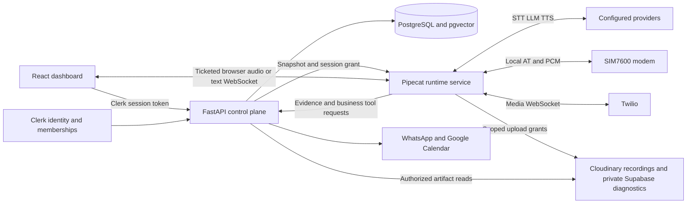

# Voice AI

A configurable voice-agent platform with a FastAPI control plane, a separate
Pipecat conversation runtime, and a React dashboard. Operators build versioned
agents, test conversations, connect business tools, and inspect each run.

Browser calls and text tests use the conversation runtime without telephone
hardware. Local cellular calls use a Waveshare SIM7600 modem. Twilio has a
separate transport adapter; live Twilio acceptance remains unverified.

Speech-to-text (STT) recognizes caller audio; the language model chooses replies
and tools; text-to-speech (TTS) generates the agent's audio.

## Capabilities

- **Agent authoring:** node prompts, task messages, transitions, conversation
  facts, provider/model choices, classifier routing, summarization and a
  per-template WhatsApp composer. Draft revisions detect conflicting edits;
  published configurations are immutable in normal operation.
- **Conversation testing:** browser audio and saved text-chat attempts share
  Pipecat Flows and tool execution. Text tests exclude STT, TTS and modem setup.
- **Business actions:** WhatsApp templates and delivery receipts, Google Calendar
  availability and booking, unconfirmed callback requests, knowledge retrieval,
  and referral capture with separate operator review.
- **Run inspection:** transcript, exchange waterfall, node visits, model inputs,
  tool delivery/consumption, interruptions, provider attempts, latency and token
  measurements. Recordings and diagnostic files load on demand.
- **Access control:** Clerk identity and organizations, built-in Admin/Member
  roles, application-owned organization ownership and separate platform access.
- **Call operations:** bounded setup, operator stop, execution leases, verified
  modem release and recovery. Missing release evidence remains unknown.

A model option or passing unit test does not establish live provider, carrier,
hosting capacity or deployment acceptance.

## Architecture



The API owns durable state, authorization, configuration and business actions.
The runtime owns live sessions, media and capture; it does not open the database
or import Clerk/vault services. The API remains the public control boundary.

Read the [architecture review index](docs/architecture/decision-index.md)
for current decisions and historical supersession notes.

## Local setup on Windows

Use Python 3.12 through `uv`, Node.js 24 and Docker Desktop for PostgreSQL.
Run these commands from the repository root. Copy examples only when the
destination does not already exist:

```powershell
uv sync
if (-not (Test-Path apps/api/.env)) { Copy-Item apps/api/.env.example apps/api/.env }
if (-not (Test-Path apps/runtime/.env)) { Copy-Item apps/runtime/.env.example apps/runtime/.env }
if (-not (Test-Path apps/dashboard/.env)) { Copy-Item apps/dashboard/.env.example apps/dashboard/.env }
docker compose --env-file apps/api/.env up -d db
uv run alembic upgrade head
```

Fill in private values before starting services. PostgreSQL defaults to port
55432; changing `VOICE_DB_PORT` also requires updating the API database URL.
Start each service in its own terminal:

```powershell
# Repository root
uv run uvicorn voice_api.main:app --host 127.0.0.1 --port 8002
```

```powershell
# Repository root
uv run uvicorn voice_runner.main:app --host 127.0.0.1 --port 8001
```

```powershell
cd apps/dashboard
npm ci
npm run dev -- --host 127.0.0.1 --port 5174 --strictPort
```

Set the dashboard's `VITE_API_ORIGIN` to `http://127.0.0.1:8002`; set the
runtime's `VOICE_API_BASE_URL` to that same API address. The API runtime base
URLs point to port 8001. Clerk authorized parties and runtime allowed origins
must include `http://localhost:5174` when that is the browser URL.

Use matching server-side control/service tokens across services.
`VOICE_RUNTIME_CONTROL_TOKEN` authorizes API-to-runtime control;
`VOICE_RUNTIME_SERVICE_TOKEN` authorizes runtime-to-API ingestion and tools.
Neither belongs in a `VITE_` variable. See each service's `.env.example` and
[runtime deployment guide](docs/deployment/RUNTIME-SPLIT.md).

Provider credentials are stored as organization-owned encrypted records and
selected by stage. Deployment owns encryption keys, runtime tokens, Clerk
credentials and storage credentials. Development retains compatibility paths;
production must use the separate runtime.

## Try and inspect a conversation

1. Sign in and select an organization.
2. Configure provider credentials, then create or clone an agent draft.
3. Configure the initial node's task message when it responds on entry. Validate
   prompts, tool bindings and transitions before testing.
4. Use **Chat test** for text or **Test agent** for browser audio. Tests can invoke
   live business tools; choose test destinations and integrations deliberately.
5. Inspect the saved conversation or voice run. Follow its pinned agent version,
   exchange, provider operation and tool result.
6. Use **End call** to stop an active voice run. Uncertain cleanup keeps ownership
   reserved until verified recovery succeeds.

Cellular calls require Windows serial drivers, an active voice-enabled SIM and
correct AT/audio ports on a runtime endpoint. COM16 and COM17 are not universal.
Hosted containers reject local SIM7600 access. The protected
[first-call reference](scripts/demo_call.py) remains available for hardware
comparison; it is not the configurable application's entry point.

## Regression tests and checks

```powershell
uv run ruff check .
uv run ruff format --check .
uv run pytest tests/unit
```

```powershell
cd apps/dashboard
npm run test:prompts
npm run test:tools
npm run build
```

Database integration tests require a separate migrated PostgreSQL database in
`VOICE_TEST_DATABASE_URL`. Never use production. Hardware and live-provider
checks are separate from offline tests.

The [regression guide](docs/testing/regression-tests.md) connects incidents to
useful tests. The [issue catalog](docs/issues/README.md) links actual problems,
code, test functions and remaining gaps. These tests are not a conversation
evaluation dataset or an LLM-as-judge benchmark; those remain future work.
No GitHub Actions workflow is currently committed.

Regenerate public contracts after changing API schemas:

```powershell
uv run python scripts/export_openapi.py
cd apps/dashboard
npm run generate
```

## Evidence and limitations

- Generated assistant text is not proof that every word reached the caller.
  Sarvam text/audio alignment during interruption remains open.
- `NO CARRIER` means the call connection ended. It does not identify who hung up
  or prove tower connectivity was lost. Attribution can remain unknown.
- Local recordings prove captured transport audio, not remote acoustic playback.
- Usage spans measure recorded operations, not account credit balances.
- Local spools and ephemeral hosting disks do not guarantee recovery after loss.
- Production sync, public login and remote artifacts require separate verification.
  The prepared October 10 import was not executed in this documentation task.

See [open investigations](docs/issues/README.md#open-investigations),
[deployment acceptance](docs/deployment/ACCEPTANCE.md), and
[documentation navigation](docs/README.md). Historical ADRs/RFCs describe decisions
at their recorded date; consult the current index before applying them.

## Repository map

| Path | Responsibility |
|---|---|
| `apps/api/voice_api` | HTTP API, Clerk access, database, configuration and business tools |
| `apps/runtime/voice_runner` | Session service, tickets, leases, admission and artifact transfer |
| `packages/voice_runtime/voice_runtime` | Pipecat host, providers, evidence and telephony |
| `packages/voice_shared/voice_shared` | Shared contracts, prompt resolution and HTTP evidence |
| `apps/dashboard` | React/Vite dashboard and public landing page |
| `contracts`, `migrations` | Published schemas and database evolution |
| `tests` | Unit and isolated database integration tests |
| `docs` | Current design, decisions, incidents and operating guides |
| `data`, `.cache`, `scratch` | Ignored local evidence and development artifacts |
